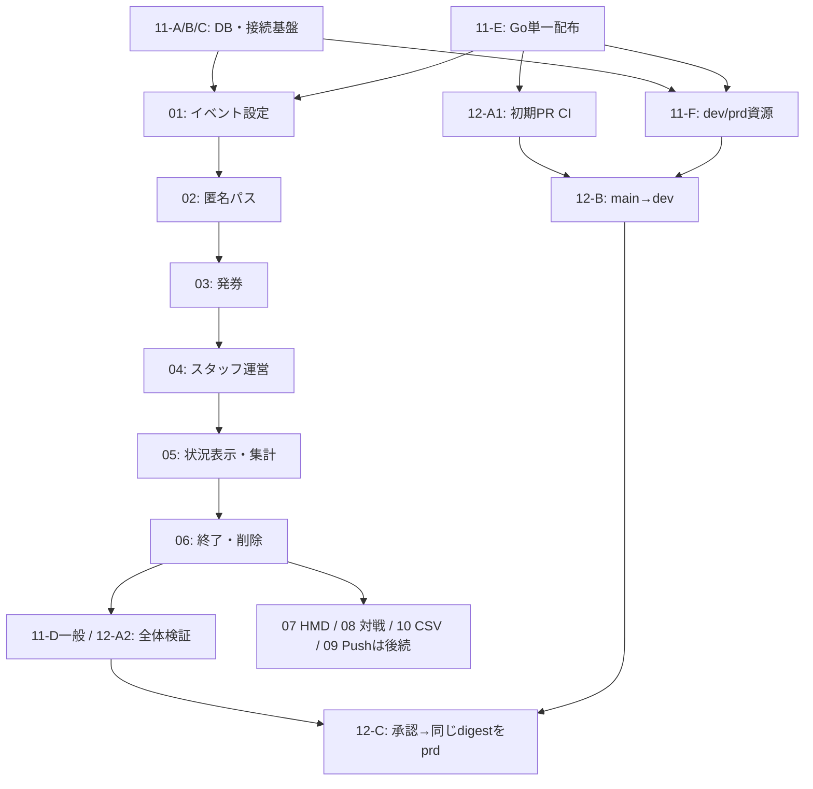

# reception-system 実装計画・依存関係

- 更新日: 2026-11-04
- 状態: 全12機能が未着手。今回の変更は計画整理のみ。コード・workflow・DB・Cloud設定・デプロイは変更していない。
- 採用方針: 個人情報不要のイベント限定受付パスと一般的な順番待ち受付。React/ViteをGoから配信し、環境ごとにUI/APIを1サービスへ統合する。PostgreSQL/sqlc/pgxとConnect-RPCを維持する。
- リリース方針: PR build/test、main更新からテスト用devへ自動配布、承認後にdev検証済みの同じdigestをprdへ昇格する。Pushは後続リリースへ延期。HMD・対戦・CSVは必要時だけ追加する。
- 調査根拠: [全体レビュー](../../.claude/reviews/review%252Fcode-review/full-review.md)、[DB設計調査](../../.claude/reviews/review%252Fcode-review/db-security-review.md)、[build/リリース調査](../../.claude/reviews/review%252Fcode-review/build-release-investigation.md)。当初のテスト成功や調査結果は新仕様の実装完了を示さない。

## 読み方と依存の定義

このREADMEは実装順・責務・リリース条件の正典。各featureは対象範囲・手順・検証の正典とする。番号は機能IDであり、11→12→01のように実装順が前後する。依存は前提の契約/実装が必要な関係で、同じPRにまとめる指示ではない。

「着手前提」と「後続機能との結合確認」を区別する。期限/FK/保存項目などの設計は関係feature間で早期に合わせるが、後続featureの実装完了を先行featureの着手条件に戻さない。未実装のオプションはUI/API/workerで無効化し、利用対象外のまま先に基本受付を完成できる。

## 機能一覧と着手前提

表の前提は直接必要なもの。推移的な前提は省略する。11/12は次の段階表で完了範囲を判定し、機能全体を一括待ちにしない。

| ID | 計画 | 直接の着手前提 | 完了する範囲 |
|---|---|---|---|
| 11 | [単一配布・環境分離・DB移行](11-safe-migration.md) | 基盤から着手可能。段階別 | 再現可能なbuild/配信・DB/環境契約・機能別移行記録 |
| 12 | [GitHub Actions](12-github-actions.md) | 段階別 | PR検証、main→dev、承認付きprd昇格 |
| 01 | [イベント設定](01-event-settings.md) | 11-A/B/C/E | event・窓口・flag・管理者基盤。未提供オプションを閉じる |
| 02 | [匿名受付パス](02-anonymous-pass.md) | 01 | パス発行/検証/復元と共通guard。券操作の本体は後続 |
| 03 | [一般発券・採番](03-ticket-issuance.md) | 02 | 共通発行API/最小UI・人数/上限・安全な採番 |
| 04 | [スタッフ運営](04-staff-operations.md) | 03 | 呼出し/取消/入場・紙券・紛失・不在運用 |
| 05 | [待ち表示・集計](05-queue-status.md) | 04 | 順位/人数/組数・polling・一覧/管理集計 |
| 06 | [終了・失効・削除](06-event-lifecycle.md) | 05 | 期限実行・個別削除・保持集計・保存先運用 |
| 07 | [HMDオプション](07-hmd-option.md) | 06（01〜05を継承） | 年齢/同意/特殊受付と追加データ削除 |
| 08 | [対戦オプション](08-matchmaking-option.md) | 06（01〜05を継承） | 選出/割当・session・入場・追加データ削除 |
| 10 | [CSV出力](10-csv-export.md) | 06（04/05を継承） | 最小項目・式安全化・出力上限と保管 |
| 09 | [Push（後続へ延期）](09-web-push-option.md) | 06。対戦通知だけ08も必要 | 購読/送信保護・queue・追加データ削除 |

07/08/10は基本契約の確定後に設計を並行できる。有効化試験は06までの完成後。07と08は独立し、HMD受付に対戦やPushを要求しない。

## 11/12の段階と前提

| 段階 | 前提ID | 成果物・完了時点 |
|---|---|---|
| 11-A | なし | migration失敗で新アプリを稼働させない |
| 11-B | 11-A | runtime/migrator/seedの接続権限と追加tableへの適用規約 |
| 11-C | 11-B | TLS・接続数・用途別のquery/lock予算 |
| 11-E | なし（11-A〜Cと並行可） | Go単一build/配信、local proxy、初期Push停止、build/smoke手順 |
| 11-F | 11-C, 11-E | Cloud dev/prdの専用資源と手動でも再現できる配布/復旧契約 |
| 12-A1 | 11-E | 既存build/通常・DB統合テストと配信smokeのPR CI初期セット |
| 12-B | 12-A1, 11-F | mainから固定digestをpublishし、テスト専用devへ自動配布 |
| 11-D一般 | 06 | 01〜06を対象に移行/基本受付の結合確認を記録 |
| 12-A2 | 11-D一般 | 一般受付E2E/競合/期限削除までrequired checksを完成 |
| 12-C | 12-A2, 12-B | 承認ゲート/候補固定/失敗・復旧を検証し、prd昇格を運用可能にする |

11-Dは1回限りの全機能完了ではない。07〜10を有効にするとき、それぞれの移行/期限/結合試験を11-Dへ追加する。12-A2も各featureのPRで試験を増やして最終化する段階で、基本機能の実装開始を待たせない。12-Cの承認設定と拒否試験は早期に準備可能だが、基本受付未完成の候補を本番へ配布しない。

## 依存関係の概略

同じ段階の実装中は、設計と局所テストを並行してよい。図の矢印は完成の前提であり、すべてを完全な逐次作業に固定するものではない。

## 推奨する実装順

1. **基盤と共通契約**: 11-A→B→Cを進め、11-Eを並行する。01のevent/項目/flagと、02/03/06の期限/FK/削除契約を先に設計する。ここではschema/API案の調整と、後続featureの実装完了待ちを混同しない。
2. **CIを早期導入**: 11-E完成後に12-A1で既存build/testを自動化し、01以降の変更から使う。未実装の基本フローE2Eを成功扱いにせず、追加した機能のPRで検証を増やす。
3. **基本受付とdev配布を並行**: 業務は01→02→03→04→05→06。これと並行し11-F→12-Bを整え、mainへ入った候補をテスト専用devへ自動配布する。未完成機能を来場者へ公開しない。
4. **一般受付の完成を検証**: 11-D一般と12-A2で、取得→待機→呼出し→入場/取消、紙券/紛失、終了/失効/削除、DB競合、Cookie/直接URLを専用データで確認する。
5. **本番昇格**: 12-Cでdev検証済み候補のSHA/digest/DB版を提示し、承認後に同じdigestをprdへ配布する。mainの再更新で承認中の候補を差し替えず、prd側schemaとの互換性を再確認する。
6. **必要なオプション**: 07/08/10は必要なものだけ、09は後続リリースとして実施する。追加schema・期限削除・機能別E2Eを各PR/11-D/12の検証へ組み込んでから有効化する。
7. **旧構成の撤去**: 既存HMD等の有効券の終了/検証済み移行を確認してから、旧PIN/API・不要列・旧frontendサービスを撤去する。任意機能未完成を理由に基本受付の独立dev試験を止めず、未確認の旧条件を勝手に解除もしない。

## 試験・有効化の条件

| 用途 | 必須の完成範囲 | 許可しないこと |
|---|---|---|
| localでのfeature確認 | 対象featureの前提と局所テスト | 未実装下流の成功や公開可能を宣言する |
| main候補の自動dev配布 | 11-A/B/C/E/F、12-A1/B、その候補の検証 | 未完成機能の公開、prdのDB/secret利用 |
| 一般受付の運用試験 | 01〜06、11-D一般/11-E、12-A2。Cloudで行う場合は上記dev配布条件も満たす | Push/HMD/対戦の有効化を待ち条件にする |
| 一般受付のprd運用 | 上記一般受付条件＋11-F/12-B/C、候補のdev合格と承認 | 再build/最新tag解決による候補差替え、未承認deploy |
| HMD/対戦/CSVの追加 | 基本条件＋対象07/08/10と期限/結合試験 | 無関係な任意機能への依存追加 |
| Push追加（後続） | 基本条件＋09、対戦通知を使う場合は08も完成 | 停止対策/claim/送信先制御が未完成の有効化 |
| 旧HMD等からの切替 | 既存イベントが必要な07/08/09の移行・有効券保持、または終了/告知済み運用変更 | 旧券の無断削除/再採番、年齢/同意条件の暗黙解除、未保護旧APIの復活 |

全チェックは未実施。既存review時のGo通常テスト/Vite build成功を新仕様の試験結果に流用しない。任意機能無効時に残る既知指摘は解決済みにせず、「利用対象外」と「修正・検証済み」を区別して管理する。

## 責務の重複を防ぐ境界

| 契約・変更 | 所有者 | 利用・結合する計画 |
|---|---|---|
| event/flag/管理者設定・基本値域 | 01 | 02〜10 |
| 匿名パスとguard | 02 | 03/04/05/09 |
| 発券・人数/上限・採番・ticket/group関係 | 03 | 04 手動入口、07/08 追加条件 |
| 通常状態遷移・入場一意/帰属・呼出結果 | 04 | 08 対戦完了、09 通知生成 |
| 読取/集計の定義と再取得方針 | 05 | 04 スタッフ、08 対戦画面、06 保持集計、10 export |
| 保存期間・削除job/対象登録 | 06 | 07/08/09が新規項目を登録し自身の完了時に結合試験 |
| build/静的配信・DB/Cloud資源・実行契約 | 11 | 各featureの追加migrationと12のworkflow |
| CI/CD・OIDC信頼条件・承認・候補/履歴 | 12 | 11のコマンド/資源を利用し、自動実行する |

不在判定は04、期限削除は06が実装と実行契約を所有する。必要な起動先/CPU/権限は11-F、自動配布への組込みは12へ引き継ぐ。Push停止と一緒にこれらを停止させる抜けを防ぐ。新しいCloud資源の増設が必須と決めつけず、実行要件と運用負担で方式を選ぶ。

## 今回解消した重複・抜け・矛盾

- 01/12が11全体の完成を待つ見え方を、11-A/B/C/E/F/Dの段階へ変更した。
- CI/CDを任意機能の後へ置く順序を修正し、初期PR CI/dev配布を基本機能と並行する。
- 02のパス完成が04の取消や05の最終一覧を待つ条件、03が04の手動画面/05の全UIを待つ条件を契約試験と後続結合に分けた。
- 04の完了条件から08の対戦完成待ちを除き、入場の共通制約を04所有へ統一した。
- 05の削除後表示をfixtureで検証し、実削除との結合を06へ移した。06は05の集計契約を明示的に前提とした。
- 06が07〜09の新規実装を待たないよう、既存データfixtureと後続の削除対象登録を分けた。08/09には削除・待ち表示の前提を補った。
- Pushの初期無効化を01〜04/11-Eの責務へ置き、延期中の09が基本リリースを妨げないようにした。
- Pushとは別に必要な不在判定/期限削除の実行主体と、無アクセス時の動作確認を追加した。
- 11の手順と12のworkflowで同じ配布ロジックを二重実装せず、コマンド/資源契約と自動実行を分けた。
- 既存HMD等の切替・旧schema撤去を一般受付の初回実装と分離し、稼働中イベントの必要条件は保持する。

## 構成見直しの方針

採用方針として、React/Vite＋Go（Connect-RPC/sqlc/pgx）＋PostgreSQLを維持し、Vite buildした画面をGoから配信する単一Webサービスへ段階改修する。設計の見直しは、基本の受付モデル・任意機能の依存・DB権限/実行経路を中心に行う。現構成を動的に検証した本番監査ではなく、repo調査と採用した用途からの設計判断である。

| 層 | 方針 | 担当 |
|---|---|---|
| 来場者/運営UI | 現Vite SPAを維持。配布時はGoが静的配信し、APIと同一origin | 02〜05/07〜11 |
| 業務API | 現Goアプリ内で基本受付とオプションの責務を分け、共通発行/状態遷移を再利用 | 01/03/04/07/08 |
| 基本データ | イベント・窓口・匿名受付主体/パス・整理券・入場記録を中心にする | 01〜04 |
| HMDデータ | 個別参加者・年齢/同意を任意の関連へ分離し、一般受付は該当行を必要としない | 03/07 |
| 関係/制約 | 循環FKや重複した帰属情報を簡素化し、一意性・同一イベント/窓口の一致をDBでも保護 | 01/03/04/08 |
| 実行/接続 | 各環境のUI/APIを単一Goイメージで配布。migrationは専用権限、APIは最小権限/TLS接続先検証 | 11 |
| 状況確認/Push | 初期は画面ポーリング。Pushの購読/配信worker/SWは無効にし、後続で実行条件を検証して追加 | 05/09/11 |
| 終了運用 | イベント別の失効/削除とログ・export・バックアップの保存管理 | 06/10/11 |

既存Goアプリ内の機能境界を整理する形から始め、マイクロサービス化、DB製品変更、ORM移行、RLS全面導入を最初の前提にはしない。共有DB/複数主催者や利用規模が増えて必要性が確認された時点で再評価する。具体的なテーブル簡素化案と制約は各機能の設計で決め、今回の計画更新で既存の正典やschemaを変更しない。

## 配布・環境の採用方針

- Node段階でVite buildし、Go module内の生成用配置へcopyしてGoへ組み込む。配布先のruntimeはGoに集約し、フロント専用nginx/Cloud Runは検証後に停止する。
- 「配布先1つ」は環境ごとのUI/API統合。Cloud devとprdはそれぞれ専用サービス・別DB/role/secretを持つ。localはVite＋Goの開発体験を保ち、proxyで同一originを再現する。
- 同一commitから作ったイメージをdigestで固定してCloud dev→prdへ昇格する。APIは同一originを使い、環境URLをVite buildへ焼き込まない。Connect-RPCとsqlcを他方式へ移行しない。
- 初期はPushなしで画面の定期更新を使う。VAPID鍵・購読・送信workerを必須にしない。既存Push利用者の切替は告知/検証し、未修正機能の延期を解決済みと記録しない。
- 現状と導入理由の調査は [build/リリース調査](../../.claude/reviews/review%252Fcode-review/build-release-investigation.md) を参照。GitHub Actionsは [独立計画12](12-github-actions.md) で、PR build/test→main更新でdev自動配布→承認後にdev検証済みの同じdigestをprdへ昇格する。11はbuild/環境/DB移行の契約、12は自動実行・Environment承認・配布履歴を担当する。今回はworkflowや設定を作成しない。

## DB調査結果の反映先

DB番号は調査事項の識別子で、既存23指摘への追加件数ではない。実DBの不整合や本番権限/TLSは未確認で、追加制約の前に件数/設定を確認する。

| DB調査 | 反映先 | 実装で確認すること |
|---|---|---|
| DB01 権限共有 | 11 | migrator/runtime/seed分離、DDL拒否、必要DML/sequence権限 |
| DB02 接続先検証 | 11 | CA/host検証、平文拒否、接続秘密値/ネットワーク管理 |
| DB03 関係の一致 | 01/03/04/08 | event/窓口帰属、循環参照簡素化、入場一意/複合FK、元状態のtx検証 |
| DB04 管理者名 | 01（移行経路は11） | 重複確認、名前の一意性、seed競合時にhash上書きなし |
| DB05 値域/可用性 | 01/03/05/07/08/09/10/11 | 基本CHECK、入力/出力上限、query/lock/接続予算 |
| DB06 保存最小化 | 02/03/06/07/09/10 | 一般受付のPII不要、HMD記録の目的/期間、Push errorの秘密値除去 |
| DB07 event/期限削除 | 01〜06/08〜11 | event境界、期限索引/バッチ削除、別開催保持、backup復元時の対応 |

## 共通の設計条件

- 来場者は名前・メール・電話・ニックネーム・PINの入力不要。一般受付は年齢/参加者個別の情報/同意記録も要求しない。基本は人数1、グループ受付だけ人数を入力する。
- 受付パスはイベント限定の推測困難な秘密値。Cookieで保持し、サーバーでイベント・有効期限・所有権を検証する。生値をログ/URL/CSVへ出さず、DBではハッシュを扱う。受付番号・公開QR・本文visitor_idは変更権限の証拠にしない。
- パス紛失とスマホなしはスタッフ対応から始める。番号やスクリーンショットだけで既存券の権限を取得できる回復APIは作らない。紙の参照番号と操作用パスを分ける。
- 同じパスでの重複発行・受付上限を制御する。匿名のまま厳密な一人一枚までは保証せず、端末指紋・恒久IDは導入しない。
- 新規イベントは一般受付、既存イベントはHMD設定へ明示的に移す。進行中の券の条件を勝手に解除しない。最初は1開催から使えればよく、複数主催者SaaSや課金は含めない。
- 機能無効はUI非表示に加えAPI/worker制御と不要データ非保存を含む。HMD・対戦・Pushはそれぞれ独立した設定とする。動画/応援は既定で非表示。未完成の応援機能の完成は今回の対象外。
- イベント終了で発券停止/パス失効、明示した保存期間の後に個別データを削除する。必要ならパス/受付番号と切り離した集計のみ残す。export・バックアップの保管期限も別に定義する。
- API契約はproto、DB変更は追加migration、sqlc/bufから生成する。既存Next.js想定の規約を現物のVite SPAへ機械適用しない。仕様書/CLAUDE.mdは01および該当feature実装時に更新する。

## 旧計画からの対応

| 旧単位 | 移行先 |
|---|---|
| U00 | 01 イベント設定 |
| U01 | 02 匿名受付パス |
| U02 | 03 発券、04 紙券/スタッフ対応 |
| U03 | 03 共通発行条件、07 HMD、08 対戦条件 |
| U04 | 03 採番 |
| U05 | 04 取消/呼出し |
| U06 | 08 対戦 |
| U07/U08/U09 | 09 Push（通知なしの基本動線は03〜05） |
| U10/U12 | 05 待ち表示・集計 |
| U11 | 10 CSV |
| U13 | 04 スタッフ一覧、05 dashboard、08 対戦画面 |
| U14 | 11 移行（新しく指定されたCI/CDの自動化は12） |
| U15 | 06 終了・削除 |

## レビュー指摘の担当

| 指摘 | 担当feature |
|---|---|
| F01/F04 | 02 |
| F03/F05/F08 | 03 |
| F06 | 07（スタッフ操作の共通基盤は04） |
| F07 | 03 共通制約、07 HMD、08 対戦 |
| F09/F16 | 04 |
| F10/F11/F13 | 08 |
| F12/F15/F02/F18/F19 | 09 |
| F14/F20/F21 | 05 |
| F17 | 10 |
| F22 | 04 スタッフ、05 dashboard、08 対戦 |
| F23 | 11 |

## 未確定値の扱い

保管日数・発券上限の単位・HMD同意記録の必要項目・Push provider・既存データ切替時間等は各計画内に記載する。実装前に現物の設定と運用条件を照合して決定し、推測した値を既存の確定仕様として扱わない。旧HMDの保存対象や有効券を計画整理のために消さない。
