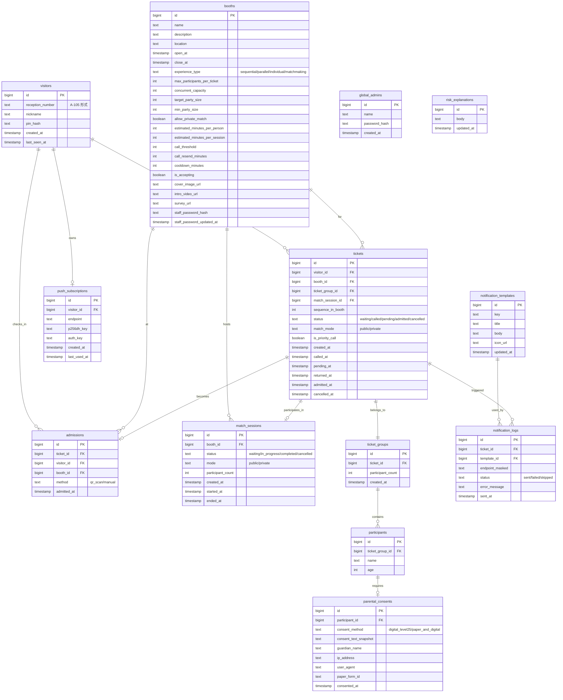

# データモデル

PostgreSQL 上のテーブル設計。**真実の源は `migrations/` 配下のマイグレーションファイル**であり、このドキュメントは概観把握用。実装は sqlc + pgx で行う。

---

## 1. ER 図(全体)



---

## 2. テーブル詳細

### 2-1. `visitors`

来場者本人。1 来場者 1 レコード。

| カラム | 型 | 制約 | 備考 |
|---|---|---|---|
| id | bigserial | PK | |
| reception_number | text | UNIQUE NOT NULL | `A-105` 等 |
| nickname | text | NOT NULL | 1〜20 文字 |
| pin_hash | text | NOT NULL | bcrypt または argon2 |
| created_at | timestamptz | NOT NULL DEFAULT now() | |
| last_seen_at | timestamptz | NOT NULL DEFAULT now() | 退場判定・分析用 |

**メールアドレス・本名等は持たない**(R-019)。

### 2-2. `push_subscriptions`

Web Push 通知のための購読情報。1 来場者 1 レコード(複数端末で連携した場合は最新を上書き)。

| カラム | 型 | 制約 | 備考 |
|---|---|---|---|
| id | bigserial | PK | |
| visitor_id | bigint | FK NOT NULL | UNIQUE 制約 |
| endpoint | text | NOT NULL | Push サーバーの URL |
| p256dh_key | text | NOT NULL | 暗号鍵 |
| auth_key | text | NOT NULL | 認証鍵 |
| created_at | timestamptz | NOT NULL DEFAULT now() | |
| last_used_at | timestamptz | NOT NULL DEFAULT now() | 通知送信時に更新 |

### 2-3. `booths`

ブース(企画)。事前に運営が登録するマスタ。

| カラム | 型 | 制約 | 備考 |
|---|---|---|---|
| id | bigserial | PK | |
| name | text | NOT NULL | |
| description | text | NOT NULL | |
| location | text | NOT NULL | |
| open_at | timestamptz | NOT NULL | 受付可能な開始時刻 |
| close_at | timestamptz | NOT NULL | 受付可能な終了時刻 |
| experience_type | text | NOT NULL | `sequential` / `parallel` / `individual` / `matchmaking` |
| max_participants_per_ticket | int | NOT NULL DEFAULT 1 | 1 整理券あたりの最大人数 |
| concurrent_capacity | int | NOT NULL DEFAULT 1 | 同時並行可能人数(parallel で使用) |
| target_party_size | int | NULL | matchmaking の理想人数 |
| min_party_size | int | NULL | matchmaking の最低開催人数 |
| allow_private_match | boolean | NOT NULL DEFAULT false | matchmaking でプライベートマッチ可 |
| estimated_minutes_per_person | int | NULL | 1 人あたりの体験時間 |
| estimated_minutes_per_session | int | NULL | 1 セッションの時間(parallel/matchmaking) |
| call_threshold | int | NOT NULL DEFAULT 3 | 呼び出しのタイミング目安 |
| call_resend_minutes | int | NOT NULL DEFAULT 10 | 呼び出し後 N 分で pending 遷移 |
| cooldown_minutes | int | NOT NULL DEFAULT 0 | 体験完了後の再取得制限時間 |
| is_accepting | boolean | NOT NULL DEFAULT true | 整理券発行の一時停止 |
| cover_image_url | text | NULL | R2 上の URL |
| intro_video_url | text | NULL | YouTube 限定公開 URL |
| survey_url | text | NULL | アンケート(Google Forms 等)URL |
| staff_password_hash | text | NOT NULL | bcrypt |
| staff_password_updated_at | timestamptz | NOT NULL | パスワード変更追跡 |

#### experience_type ごとの必須フィールド

| タイプ | 必須 |
|---|---|
| `sequential` | max_participants_per_ticket, estimated_minutes_per_person |
| `parallel` | max_participants_per_ticket, concurrent_capacity, estimated_minutes_per_session |
| `individual` | (max_participants_per_ticket = 1 固定), estimated_minutes_per_person |
| `matchmaking` | target_party_size, min_party_size, allow_private_match, estimated_minutes_per_session |

これは CHECK 制約またはアプリケーション側のバリデーションで担保。

### 2-4. `tickets`

整理券。1 ブースで 1 来場者は同時に 1 枚のみ持てる(`waiting`/`called`/`pending` のいずれか)。

| カラム | 型 | 制約 | 備考 |
|---|---|---|---|
| id | bigserial | PK | |
| visitor_id | bigint | FK NOT NULL | |
| booth_id | bigint | FK NOT NULL | |
| ticket_group_id | bigint | FK NOT NULL | |
| match_session_id | bigint | FK NULL | matchmaking でセッション開始時に紐付け |
| sequence_in_booth | int | NOT NULL | ブース内の発行順 |
| status | text | NOT NULL | enum 相当 |
| match_mode | text | NULL | matchmaking のみ。`public` / `private` |
| is_priority_call | boolean | NOT NULL DEFAULT false | pending から復帰した優先呼び出し |
| created_at | timestamptz | NOT NULL DEFAULT now() | |
| called_at | timestamptz | NULL | |
| pending_at | timestamptz | NULL | |
| returned_at | timestamptz | NULL | pending から復帰した時刻 |
| admitted_at | timestamptz | NULL | |
| cancelled_at | timestamptz | NULL | |

#### 部分ユニーク制約(R-007)

```sql
CREATE UNIQUE INDEX tickets_active_per_booth_visitor
  ON tickets (booth_id, visitor_id)
  WHERE status IN ('waiting', 'called', 'pending');
```

これにより、同じ来場者が同じブースで同時に複数の active な整理券を持つことを禁止。

### 2-5. `ticket_groups` と `participants`

1 つの整理券で複数人参加する場合のグループ。

#### `ticket_groups`

| カラム | 型 | 制約 |
|---|---|---|
| id | bigserial | PK |
| ticket_id | bigint | FK NOT NULL UNIQUE |
| participant_count | int | NOT NULL |
| created_at | timestamptz | NOT NULL DEFAULT now() |

#### `participants`

| カラム | 型 | 制約 | 備考 |
|---|---|---|---|
| id | bigserial | PK | |
| ticket_group_id | bigint | FK NOT NULL | |
| name | text | NULL | 13 歳未満の場合は必須 |
| age | int | NOT NULL | 0〜120 |

### 2-6. `parental_consents`

13 歳未満の参加者がいる場合の保護者同意の記録(R-005)。

| カラム | 型 | 制約 | 備考 |
|---|---|---|---|
| id | bigserial | PK | |
| participant_id | bigint | FK NOT NULL UNIQUE | |
| consent_method | text | NOT NULL | `digital_level25` / `paper_and_digital` |
| consent_text_snapshot | text | NOT NULL | 同意時のリスク説明文 |
| guardian_name | text | NOT NULL | 自己申告 |
| ip_address | inet | NOT NULL | デジタル同意の証跡 |
| user_agent | text | NOT NULL | デジタル同意の証跡 |
| paper_form_id | text | NULL | 紙の管理 ID(7〜9 歳のみ) |
| consented_at | timestamptz | NOT NULL DEFAULT now() | |

7〜9 歳のフローでは `consent_method = 'paper_and_digital'`、`paper_form_id` に紙の管理番号を入力する。

### 2-7. `match_sessions`

マッチメイキング型ブース固有。複数の整理券を結合した 1 セッション。

| カラム | 型 | 制約 | 備考 |
|---|---|---|---|
| id | bigserial | PK | |
| booth_id | bigint | FK NOT NULL | |
| status | text | NOT NULL | `waiting` / `in_progress` / `completed` / `cancelled` |
| mode | text | NOT NULL | `public` / `private` |
| participant_count | int | NOT NULL | 結合された総人数 |
| created_at | timestamptz | NOT NULL DEFAULT now() | |
| started_at | timestamptz | NULL | called 遷移時 |
| ended_at | timestamptz | NULL | completed 遷移時 |

詳細は `features/match.md` を参照。

### 2-8. `admissions`

入場処理の記録。

| カラム | 型 | 制約 | 備考 |
|---|---|---|---|
| id | bigserial | PK | |
| ticket_id | bigint | FK NOT NULL | |
| visitor_id | bigint | FK NOT NULL | |
| booth_id | bigint | FK NOT NULL | |
| method | text | NOT NULL | `qr_scan` / `manual` |
| admitted_at | timestamptz | NOT NULL DEFAULT now() | |

スタッフ ID は記録しない(R-011、共有パスワード方式のため)。代わりに、操作した端末の IP やセッション情報をログに残す検討は将来課題。

### 2-9. `global_admins`

全体管理者の認証情報。1〜数行のみ。

| カラム | 型 | 制約 |
|---|---|---|
| id | bigserial | PK |
| name | text | NOT NULL |
| password_hash | text | NOT NULL |
| created_at | timestamptz | NOT NULL DEFAULT now() |

### 2-10. `notification_templates`

Web Push 通知のテンプレート。全体管理者が編集可能。

| カラム | 型 | 制約 | 備考 |
|---|---|---|---|
| id | bigserial | PK | |
| key | text | UNIQUE NOT NULL | `application_completed`, `call_initial`, `call_resent` 等 |
| title | text | NOT NULL | Push 通知のタイトル |
| body | text | NOT NULL | Push 通知の本文 |
| icon_url | text | NULL | Push 通知に表示するアイコン |
| updated_at | timestamptz | NOT NULL | |

Web Push の制約上、本文は短く(目安 100 文字以内)、HTML は使えない。

### 2-11. `notification_logs`

Web Push の送信ログ。

| カラム | 型 | 制約 | 備考 |
|---|---|---|---|
| id | bigserial | PK | |
| ticket_id | bigint | FK NULL | 関連する整理券 |
| template_id | bigint | FK NOT NULL | |
| endpoint_masked | text | NOT NULL | Push エンドポイント URL の一部のみ |
| status | text | NOT NULL | `sent` / `failed` / `skipped` |
| error_message | text | NULL | 失敗時の理由 |
| sent_at | timestamptz | NOT NULL DEFAULT now() | |

### 2-12. `risk_explanations`

リスク説明文の現行バージョン。1 行のみのテーブル(または UPSERT で運用)。

| カラム | 型 | 制約 |
|---|---|---|
| id | bigserial | PK |
| body | text | NOT NULL |
| updated_at | timestamptz | NOT NULL |

`parental_consents.consent_text_snapshot` には、同意した時点の `body` をコピーする。後から `risk_explanations.body` を更新しても、過去の同意記録には影響しない。

---

## 3. インデックス設計

### `tickets`

```sql
-- ブース別の active なチケット集計用
CREATE INDEX tickets_booth_status_idx ON tickets (booth_id, status);

-- 来場者別のチケット一覧用
CREATE INDEX tickets_visitor_idx ON tickets (visitor_id);

-- ブース内の順位計算用
CREATE INDEX tickets_booth_sequence_idx ON tickets (booth_id, sequence_in_booth);

-- マッチセッション関連の検索用
CREATE INDEX tickets_match_session_idx ON tickets (match_session_id) WHERE match_session_id IS NOT NULL;

-- 部分ユニーク(R-007)
CREATE UNIQUE INDEX tickets_active_per_booth_visitor_idx
  ON tickets (booth_id, visitor_id)
  WHERE status IN ('waiting', 'called', 'pending');
```

### `visitors`

```sql
CREATE UNIQUE INDEX visitors_reception_number_idx ON visitors (reception_number);
```

### `admissions`

```sql
CREATE INDEX admissions_booth_admitted_idx ON admissions (booth_id, admitted_at);
```

### `match_sessions`

```sql
CREATE INDEX match_sessions_booth_status_idx ON match_sessions (booth_id, status);
```

---

## 4. データの一貫性

### トランザクション境界

#### 整理券取得時
1 トランザクション内で実施:
- visitors の存在確認(認証チェック後)
- booths の存在・受付可能性確認(`is_accepting = true`、現在時刻が `open_at`〜`close_at` 内)
- 重複チェック(R-007 の部分ユニークインデックスに依存)
- クールダウンチェック(直近の admitted から `cooldown_minutes` 経過しているか)
- ブース内シーケンス採番
- tickets / ticket_groups / participants / parental_consents の作成
- 通知テンプレート(`application_completed`)を notification_logs にエンキュー

#### 入場処理時
1 トランザクション内で実施:
- tickets の status を `called` または `pending` から `admitted` に更新
- admissions レコード作成
- (matchmaking ブースの場合) match_sessions の status 更新

#### マッチング時(matchmaking ブース)
1 トランザクション内で実施:
- 待機中の tickets を `target_party_size` まで結合
- match_sessions レコード作成、関係する tickets の `match_session_id` を更新
- 関係する全 tickets を `called` に遷移
- 通知テンプレート(`call_initial`)を notification_logs にエンキュー

### 楽観ロックの適用箇所

- 整理券のステータス変更: `version` カラムまたは `updated_at` で楽観ロック
- 同時に「呼び出し」と「キャンセル」が来た場合などに使用

### 受付番号の採番

- データベースのシーケンスまたは専用カウンタテーブルでアトミックに採番
- 競合時はトランザクションでリトライ
- 999 を超えたら次のアルファベットへ進むロジックは Go 側で実装

---

## 5. 大規模アクセスへの配慮

### 読み取り頻度が高い箇所

- ブースの待ち人数表示(画面 polling のため、1 来場者あたり数秒に 1 回)
- 来場者自身の整理券状態(同上)

これらは:
- アプリケーション側で数秒のキャッシュを持つ
- DB クエリでは適切なインデックスを使い、フルスキャンを避ける
- 状況によっては Redis 等のキャッシュ層導入(MVP 後の選択肢)

### 書き込みのピーク

- 整理券取得が連続発生する瞬間
- ブース別のシーケンス採番で競合する可能性
- → トランザクションを短く保ち、ロック時間を最小化

---

## 6. データ保持期間

- イベント終了後、個人情報を含むレコードは所定期間後に削除する
- **未決定**: 削除タイミングと方法。MVP 実装中盤までに決める

---

## 7. 注意事項(実装時)

- このドキュメントはあくまで設計概観。実装は `proto/` の API 定義と `migrations/` の DDL を真実の源として進める
- 規約(`docs/coding/backend.md`)に従い、**`gen/` 配下の sqlc 生成物は手動編集禁止**
- repository では sqlc 生成型をドメイン型(`internal/feature/<機能>/types.go`)に変換して返す
- マイグレーションを変更する際は、規約「変更困難な領域は事前確認」に従い、必ず計画を提示してから実装する
- 個人情報を含むカラム(`participants.name`, `parental_consents.guardian_name`, `parental_consents.ip_address` 等)はログに出さない(R-019)
