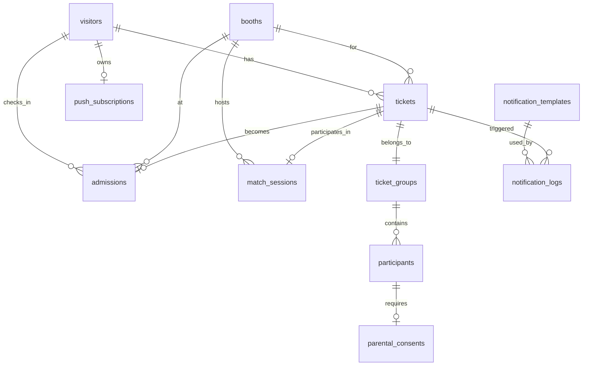
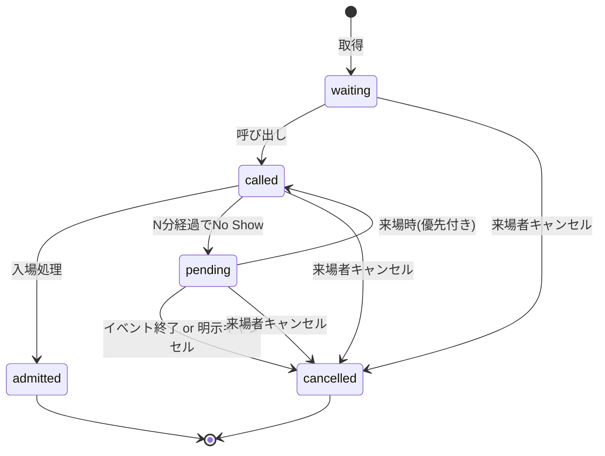
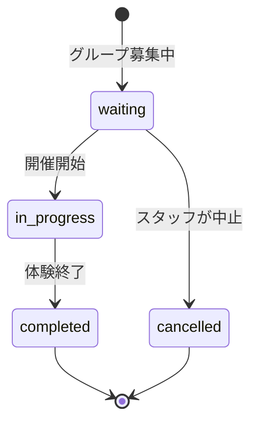

# ドメインモデル・用語定義

このシステム特有の用語と業務ルールを定義する。実装する際の変数名・型名・テーブル名は、ここに書かれた語彙を**そのまま英訳した形**で使うこと。

---

## 1. 主要な用語

| 日本語 | 英語(実装で使う名前) | 定義 |
|---|---|---|
| 来場者 | Visitor | イベントに来場し、ニックネームと PIN を登録した個人 |
| 受付番号 | ReceptionNumber | 来場者の識別番号(例: `A-105`)。来場者ごとに 1 つ |
| PIN | Pin | 来場者が登録する 4 桁の数字。再ログイン時に使う |
| 来場証(QR) | AdmissionQrCode | 来場者の受付番号を埋め込んだ QR コード。受付時に発行、スタッフがスキャンする |
| 企画 / ブース | Booth | イベント内で開催される個別の体験・展示 |
| 体験タイプ | ExperienceType | ブースごとの体験形態。4 種類(sequential / parallel / individual / matchmaking) |
| 整理券 | Ticket | 来場者がブースに対して取得する予約。1 来場者が複数ブースの整理券を持てる |
| 整理券グループ | TicketGroup | 代表者が複数人分まとめて取得した整理券のグループ |
| 体験人数 | ParticipantCount | 1 つの整理券グループでブースに参加する人数 |
| 代表者 | Representative | 整理券を取得する来場者本人。グループの場合は代表 1 名 |
| 保護者同意 | ParentalConsent | 13 歳未満の参加者がいる場合に必要となる同意の記録 |
| 入場処理 | Admission | スタッフがブースで来場者を受け入れる操作 |
| 呼び出し | Call | 整理券を持つ来場者を体験開始に呼び出す通知 |
| クールダウン | Cooldown | 体験完了後、同じブースを再度予約できない期間 |
| 保留 | Pending | 呼び出し後に来場しなかった整理券の保留状態 |
| マッチセッション | MatchSession | マッチメイキング型ブースで複数の整理券を結合した 1 回分の体験単位 |
| Push 購読 | PushSubscription | 来場者のブラウザが Web Push 通知を受け取るための情報 |
| アンケート | Survey | 体験後に来場者が回答するフィードバック(MVP では Google Forms へ誘導) |

---

## 2. 主要なエンティティと関係

### 各エンティティの位置づけ

- **Visitor**: 来場者本人。受付番号と PIN で識別される。1 人 1 レコード
- **PushSubscription**: 来場者のブラウザが通知を受け取るための情報(VAPID + endpoint + keys)
- **Booth**: ブース。事前にスタッフが登録する固定マスタ。`experience_type` を持つ
- **Ticket**: 「ある来場者がある時刻にあるブースの整理券を取得した」という記録
- **TicketGroup**: 1 枚の整理券で複数人参加する場合の参加者グループ
- **MatchSession**: マッチメイキング型ブースで、複数の整理券を結合した 1 セッション
- **Admission**: 「ある時刻にあるブースである整理券を消化(入場処理)した」という記録

> **重要**: 「受付番号」は Visitor の属性であって独立したエンティティではない。「整理券」は Ticket であって受付番号とは別。混同しないこと。

---

## 3. 状態遷移

### Ticket(整理券)の状態

| 状態 | 説明 |
|---|---|
| `waiting` | 整理券取得済、まだ呼び出されていない |
| `called` | 呼び出し中。入場可能な状態 |
| `pending` | 呼び出し後 N 分経過しても来場せず、いったん保留(待機列からは除外、再通知済み) |
| `admitted` | 入場処理が完了した。体験中または体験後 |
| `cancelled` | キャンセルされた整理券 |

### MatchSession の状態(matchmaking ブース固有)

詳細は `features/match.md` を参照。

---

## 4. 業務ルール(理由つき)

### R-001: 受付番号の形式

- 形式: `<アルファベット 1 文字>-<3 桁数字>` (例: `A-105`、`B-042`)
- 連番が `A-999` に達したら自動で `B-001` に進む
- アルファベットは A〜Z の順、Z を超えたらシステムでエラーログ記録(イベント規模上は到達しない想定)
- **理由**: 短く、声に出して言いやすく、目視で覚えやすい形式にするため

### R-002: PIN は 4 桁数字

- 形式: `0000` から `9999` の 4 桁
- **理由**: 来場者(全年齢)が即座に決められて、覚えやすい桁数にするため
- セキュリティが強固でないことは許容。代わりに、再ログインには **受付番号 + PIN の組み合わせ**が必須なので、総当たり攻撃の現実的なリスクは低い

### R-003: ブラウザ側の状態保持

- 受付完了時に、来場者の受付番号と QR コードはブラウザの localStorage に保存する
- これによりリロード・再訪問時に即座に画面が復元される
- **理由**: 来場者にスクショを促してもスクショを忘れる人がいる。複数の保険を用意することで離脱を防ぐ

### R-004: 失念時の再ログイン

- ブラウザ状態が消失した場合のみ、来場者は **受付番号 + PIN** で再ログインできる
- 受付番号も PIN も忘れた場合は、運営の手作業で対応(別ルート)
- **理由**: 二段階認証を本人確認の代替とし、よりシンプルな運用を維持するため

### R-005: 年齢ポリシーと同意フロー

参加者の年齢に応じて、以下のフローを適用する。

| 年齢 | 受付方式 | 保護者同伴 | 同意取得方法 |
|---|---|---|---|
| 7 歳未満 | 受付不可 | - | - |
| 7〜9 歳 | スタッフ介在の特殊フロー | 必須 | 紙の同意書 + デジタル記録(ハイブリッド) |
| 10〜12 歳 | オンライン受付可 | 必須 | デジタル同意(レベル 2.5) |
| 13 歳以上 | オンライン受付可 | 不要 | 本人同意のみ |

- **理由**:
  - HMD 体験は機器メーカー(Meta 等)の推奨年齢が 10 歳以上であり、運営の善管注意義務を考慮
  - 7〜9 歳はスタッフが対面で説明する余地が必要なため、オンライン完結ではなく介在型にする
  - 紙の同意書を併用することで、自筆署名による法的拘束力を補強

### R-005-2: デジタル同意「レベル 2.5」の構成要素

10〜12 歳で必須となるデジタル同意では、以下を保存する。

- 同意した時点のリスク説明文の全文スナップショット
- 保護者氏名(自己申告)
- 体験参加者の氏名
- 同意した時刻、IP アドレス、User Agent
- 同意ボタンの前にリスク説明文を末尾までスクロールしないと押せない UI

- **理由**: 単なるチェックボックスではなく、「ちゃんと説明し、同意を得た」を後から証明できる構成にする

### R-006: 1 来場者が複数ブースの整理券を持てる

- 来場者は複数のブースで同時に整理券を保持できる
- ただし、同じブースで同時に複数の整理券を持つことはできない
- 体験完了後、`cooldown_minutes` 経過後に再取得可能(R-007 参照)
- **理由**: 1 つのイベントで複数の体験を回るのが自然な動線のため

### R-007: 同じブースの再体験とクールダウン

- 1 ブースで `waiting` または `called` または `pending` 状態の整理券は同時に 1 枚のみ
- 体験完了(`admitted` 状態)後、ブースに設定された `cooldown_minutes` が経過するまで、新しい整理券は取得できない
- `cooldown_minutes = 0` の場合はクールダウンなし(完了直後に再取得可能)
- **理由**:
  - HMD 体験は連続装着すると目の疲労が蓄積するため、休息時間を強制する
  - ブースの性質によって適切な休息時間が違うため、ブースごとに設定可能とする

### R-008: 整理券の呼び出しタイミング

- ブース運営者が手動で「呼び出す」操作を行う
- スタッフは「先頭の整理券を呼び出す」または「N 件まとめて呼び出す」ことができる
- N の運用上の目安はブースの `call_threshold` で示す(自動呼び出しではなく目安値)
- **理由**: 体験の進行ペースは現場判断が必要なため、自動化せず手動とする

### R-009: 入場処理は QR スキャンが基本

- スタッフはタブレット等で来場者の QR コードを読み取り、入場処理を行う
- QR が読めない・忘れた場合のみ、手動で受付番号を入力して処理する
- **理由**: 操作ミスを減らし、捌く速度を最大化するため

### R-010: 入場後の状態と画面切り替え

- スタッフが QR を読み取って入場処理(`admitted`)した時点で、来場者の画面は QR 表示からアンケート誘導画面に切り替わる
- 来場者が画面を見るタイミング(リロード or 再訪問時)で反映される
- アンケートはブースに設定された `survey_url`(Google Forms 等)へのリンクとして表示する
- **理由**: 来場者が手動で「終わった」を押す必要なく、自然にアンケートへ誘導できる

### R-011: スタッフの権限とログイン

- スタッフは、ブースごとに発行された**共有パスワード**でログインする
- スタッフ個人の特定はせず、操作ログには「どのブースで」「いつ」までを記録
- 全体管理者は別ルートでログインする(専用 ID + パスワード)
- パスワードはブース設定画面から全体管理者が変更できる
- **理由**: 運用シンプル最優先(R-002 と同様、運用容易性 vs 厳密性のトレードオフを許容)

### R-012: 呼び出し後の No Show 対応(pending 状態)

- 呼び出し(`called`)後、ブースに設定された `call_resend_minutes` が経過しても入場処理されない場合、整理券は `pending` 状態に遷移する
- pending 遷移時に再通知(Web Push)を送る
- pending 状態の整理券は待機列のカウントから除外される(他の来場者の待ち時間を増やさない)
- **理由**: 「遅れたが体験したい」人を排除しないが、他の人を待たせない設計

### R-013: pending からの復帰と優先呼び出し

- pending 状態の来場者がブースに到着し、QR をスキャンしたら、整理券は `called` 状態に戻り、`is_priority_call = true` フラグが立つ
- スタッフ画面では「優先呼び出し」として目立つ表示で表示される
- 通常の `called` よりも優先して処理される
- **理由**: 戻ってきた来場者を待たせず、現在体験中の人が終わったらすぐ次に処理できる

### R-014: 整理券のキャンセル可能タイミング

- 来場者は `waiting` / `called` / `pending` 状態の整理券をキャンセルできる
- `admitted` 状態ではキャンセル不可
- スタッフは運営判断で任意の状態の整理券をキャンセルできる
- **理由**: 来場者の自発的な辞退を阻害しない、後続の整理券を素早く処理できる

### R-015: 体験タイプ(experience_type)とブースの挙動

ブースは以下の 4 タイプのいずれかを取る。

| タイプ | 1 整理券の人数 | グループ間結合 | 体験順序 |
|---|---|---|---|
| `sequential` | 1〜N 人 | なし | グループ内順次 |
| `parallel` | 1〜N 人 | なし | グループ内同時 |
| `individual` | 1 人固定 | なし | 1 人ずつ |
| `matchmaking` | 1〜N 人 | あり(public モードのみ) | 結合グループ同時 |

- 各タイプの待ち時間計算式は `data-model.md` および `features/ticket.md` を参照
- **理由**: ブースの物理的な体験形態に合わせて、整理券の挙動を変える必要がある

### R-016: マッチメイキング型ブースの 2 モード

`matchmaking` ブースでは、整理券取得時に以下のモードを選択できる。

- **public**: 他のグループと結合して `target_party_size` 人数で開催
- **private**: 自分のグループ内のみで開催(人数が `min_party_size` 以上であれば可)

- 詳細は `features/match.md` を参照
- **理由**: 友人・家族同士で遊びたい需要と、人数を効率よく集めて回したい需要の両方に対応

### R-017: マッチメイキングの強制開催

- public モードの待機列が `target_party_size` に達しない場合でも、スタッフは `min_party_size` 以上であれば強制開催できる
- 強制開催した場合、待機列の整理券は全て `called` 状態に遷移する
- **理由**: 待ち時間の長期化を防ぐため、運営判断で開催できる余地を残す

### R-018: メディア(画像・動画)の扱い

- 画像はサーバーから R2(または S3 互換ストレージ)に保存し、Public URL でブラウザに配信
- 動画は YouTube 限定公開を埋め込み(URL のみシステムに保存)
- ブース情報の編集は管理画面の GUI で行う
- **理由**: ストレージコスト最小化と、運営の編集容易性を両立

### R-019: 個人情報の最小化

- メールアドレス・本名・住所・電話番号等は取得しない
- 来場者の識別情報は受付番号と PIN のみ
- 保護者同意フローでは、保護者氏名は自己申告として記録するが、確認は行わない
- **理由**: PII の保管リスクと運営工数を最小化、運営事故時の影響範囲も限定

### R-020: 通知チャネル

- 通知は Web Push 通知(VAPID) と画面 polling のハイブリッドで運用する
- 来場者が Web Push を有効にしているかどうかに関わらず、画面 polling は常に動作する
- メール通知・SMS 通知・LINE 通知は MVP に含まない
- **理由**: 個人情報を取得せずに通知を実現するため

---

## 5. スケールに関するメモ

- 同時アクセス 10,000 人を想定
- 「整理券取得」のような書き込みは、1 人につき数回程度(ブース選択の度)
- 「順番確認」のような読み取りは、頻繁に発生しうる(画面 polling のため)
- → **読み取りに対するキャッシュ戦略**が、スケールの鍵となる
- Cloud Run の自動スケーリングと、Connect-RPC 由来のステートレス設計で対応

---

## 6. 未決定事項

実装前に決定が必要、または実装中に決められる事項。

### 実装中盤までに決める

- データ保持期間(イベント終了後の削除タイミング)
- API レート制限(同一 IP からの大量リクエスト制限)
- PIN 試行回数制限
- スタッフパスワードのブルートフォース対策
- 利用規約・プライバシーポリシーの文面

### 実装時の判断で OK

- 想定待ち時間の計算で過去データを使うか、ブース設定値固定か
- 同じ来場者が複数端末でログインしている場合の扱い
- 「受付番号も PIN も忘れた」場合の運用フロー(マニュアル対応)
- マッチメイキングのエッジケース(`features/match.md` 参照)

### v2 以降で検討

- LINE 連携(LINE Messaging API)
- 多言語対応(英語等)
- アクセシビリティ(WCAG レベル A)
- スタッフの個人アカウント方式
- 体験中の機器ステータス監視
