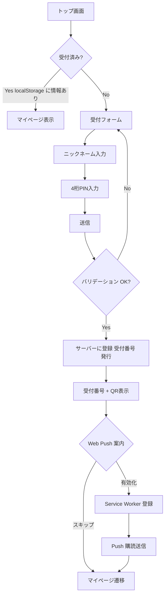

# 機能: 受付・認証

来場者がイベントに来た最初の関門。ニックネームと PIN を登録し、受付番号と QR コードを発行する。Web Push 通知の購読登録もこの段階または直後に行う。

---

## 1. 機能概要

来場者がイベント会場に着いたとき、最初に通る画面。来場者の基本情報を登録し、本人を識別する受付番号と QR コードを発行する。発行後の情報はブラウザの localStorage に保存し、QR コードのスクショ取得を強く促す。Web Push 通知の購読も受付完了直後にオプションで案内する。

**個人情報(メアド・本名・住所等)は一切取得しない**。来場者の識別はニックネーム + 受付番号 + PIN のみで行う(R-019)。

---

## 2. ユーザーストーリー

- 来場者として、最初に名前と PIN を入れて、自分の識別情報を取得したい
- 来場者として、受付番号と QR コードを画面に表示してもらい、スクショで保存したい
- 来場者として、ブラウザを閉じてしまっても、受付番号と PIN で再ログインしたい
- 来場者として、登録は最小の手間で済ませたい(年齢入力は整理券取得時で OK)
- 来場者として、Web Push 通知を受け取るかどうかを自分で選びたい

---

## 3. 受付フロー(初回)

---

## 4. 画面と振る舞い

### 4-1. トップ画面

- 来場者が最初に開く画面
- localStorage に受付番号と PIN ハッシュがあれば、自動的にマイページに遷移
- なければ受付フォームへ

### 4-2. 受付フォーム

入力項目:

| 項目 | 必須 | バリデーション |
|---|---|---|
| ニックネーム | 必須 | 1〜20 文字、改行不可 |
| 4 桁 PIN | 必須 | `^[0-9]{4}$` |
| 4 桁 PIN(確認) | 必須 | 上の PIN と一致 |

備考:

- メールアドレス・本名・住所等は**取得しない**
- 年齢入力は受付フォームでは**しない**(整理券取得時に行う)
- ニックネームは重複可(受付番号で一意になるため)

### 4-3. 受付番号 + QR 表示画面

- 大きく受付番号を表示(例: `A-105`)
- QR コードを表示(中身は受付番号、または受付番号を含む URL)
- **「必ずスクショしてください」を強く明示**(背景色・フォントを目立たせる)
- 「次へ」ボタンで Web Push 案内画面へ

### 4-4. Web Push 案内画面(オプション)

- 「呼び出されたタイミングで通知を受け取る」ボタンを表示
- スキップ可能、後でマイページからも有効化できる
- 有効化を選んだ場合:
  1. ブラウザの通知許可ダイアログを表示(Notification.requestPermission())
  2. 許可されたら Service Worker を登録
  3. PushManager.subscribe() で購読情報を取得
  4. サーバーに購読情報を送信(`RegisterPushSubscription`)
- 拒否されたら、画面 polling のみで運用される旨を伝える

### 4-5. マイページ(受付済み画面)

- 自分の受付番号と QR コードを常に再表示できる
- 取得済み整理券の一覧を表示
- 各ブースへのリンク
- Web Push の有効/無効ボタン
- ログアウトリンク(localStorage クリア)

### 4-6. 再ログインフォーム

ブラウザを変えた、localStorage が消えた、別端末で見たい等のケース。

入力項目:

| 項目 | 必須 | バリデーション |
|---|---|---|
| 受付番号 | 必須 | `^[A-Z]-\d{3}$` 形式 |
| 4 桁 PIN | 必須 | `^[0-9]{4}$` |

成功時: localStorage に情報を再保存し、マイページへ遷移
失敗時: 「受付番号または PIN が違います」と表示。試行回数制限は MVP では設けない(運用で対応)

---

## 5. 状態保存(localStorage)

### 保存内容

| キー | 値 | 用途 |
|---|---|---|
| `reception_number` | `"A-105"` | 受付番号 |
| `pin_hash` | ハッシュ化した PIN | 自動再ログイン時の認証 |
| `last_login_at` | ISO 日時文字列 | セッション期限管理(MVP では未使用でも保存) |

### 注意

- PIN そのものは **localStorage に保存しない**。ハッシュ化した値のみ保存
- ハッシュ化は SHA-256 + 受付番号をソルトに使う(簡易な実装で OK)
- localStorage アクセスはクライアント JavaScript のみ。サーバーには毎回 PIN ハッシュを送って検証

---

## 6. サーバー側の処理

### 受付登録(`CreateVisitor`)

入力:
- ニックネーム
- PIN(平文。HTTPS 前提で送信、サーバー側で即座にハッシュ化)

処理:
1. 受付番号を発行(R-001 の形式に従う、A-001 から連番、999 で B 等に進む)
2. PIN をハッシュ化(bcrypt または argon2)して保存
3. Visitor レコードを作成
4. 受付番号と発行時刻を返す

出力:
- 受付番号(`A-105` 等)
- QR コードに埋め込む値(受付番号そのもの、または署名付きトークン)

### 再ログイン(`AuthenticateVisitor`)

入力:
- 受付番号
- PIN(平文)

処理:
1. 受付番号で Visitor を検索
2. PIN を入力した値をハッシュ化して比較
3. 一致したら成功、`last_login_at` を更新
4. 不一致なら認証失敗

出力:
- 成功 / 失敗
- 成功時のみ Visitor 情報

### Web Push 購読登録(`RegisterPushSubscription`)

入力:
- 受付番号(認証済みコンテキストから)
- endpoint: Push サービスの URL
- p256dh_key: 暗号鍵
- auth_key: 認証鍵

処理:
1. visitor_id を特定
2. 既存の `push_subscriptions` レコードがあれば UPSERT(端末を変えた場合に対応)
3. 保存

### 受付番号の発行アルゴリズム

- アルファベット A〜Z を順に消費(A-001〜A-999、次に B-001〜B-999、...)
- DB のシーケンスまたはアトミックなカウンタで採番
- 競合(同時受付)を考慮し、トランザクション内で採番する
- 999 を超えたら次のアルファベットへ進むロジックは Go 側で実装
- Z-999 を超えた場合はエラーログ + 全体管理者に通知(イベント規模上は到達しない想定)

---

## 7. エラーケースと UX

| エラー | UX |
|---|---|
| ネットワーク失敗(受付登録) | 「もう一度お試しください」+ 再送信ボタン |
| ネットワーク失敗(再ログイン) | 同上 |
| PIN 不一致 | 「受付番号または PIN が違います」(どちらが違うかは伏せる) |
| サーバー側エラー(500 系) | 「システムエラーです。スタッフにお声がけください」 |
| QR 表示の生成失敗 | 受付番号を大きく表示し、手入力での代替を案内 |
| Web Push 通知許可拒否 | 「画面を開いたままにしてください」と案内 |
| Service Worker 登録失敗 | 同上、ログのみ記録、来場者には通知許可なしと同じ扱い |

---

## 8. テスト方針

R-009(入場後の画面切り替え)と R-004(再ログイン)は**重要箇所**(ユーザーが詰まると運営が止まる)。

- 受付登録 → 受付番号採番: TDD で書く
- 再ログイン認証: TDD で書く
- PIN ハッシュ化と検証: TDD で書く
- 受付番号のアルファベット切替: TDD で書く(A-999 → B-001 の境界)
- Push 購読登録: アフターで OK
- 重複ニックネームでの登録: アフターで OK
- localStorage の保存・復元: フロントエンドの hook テストで書く

---

## 9. 未決定事項

- PIN 試行回数の制限(MVP は無制限、本番運用で要検討)
- 「受付番号も PIN も忘れた」場合の運用フロー(マニュアル対応)
- 同じ来場者が複数端末でログインしている場合の扱い(Push 購読は最後の端末で上書き)
- 来場者の identity を継承する形でのテスト用ダミーアカウント生成
