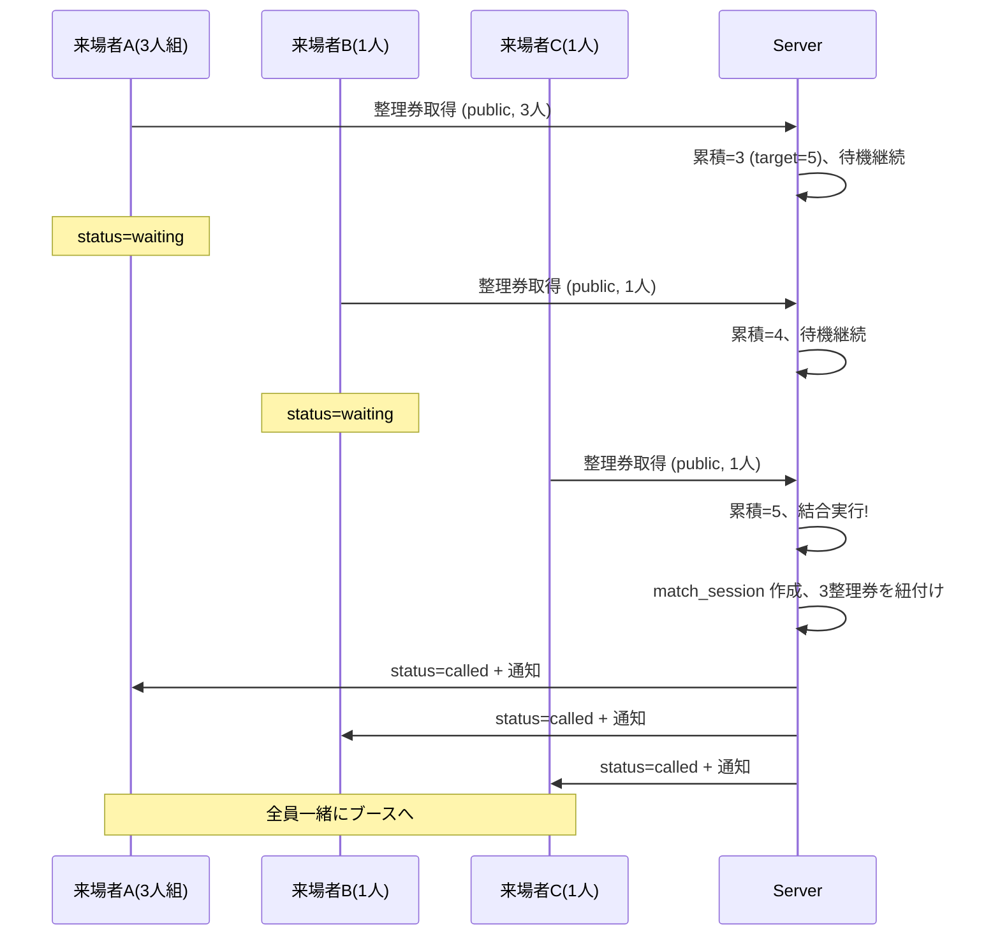
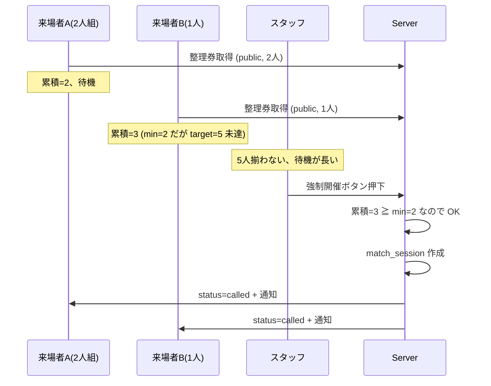

# 機能: マッチメイキング型ブース

`experience_type = matchmaking` のブース固有のロジックを集約。5 人対戦ゲーム等、複数の整理券グループを結合して 1 つのセッションとして開催するブース向け。

---

## 1. 機能概要

5 人対戦ゲーム等のブースで、複数のグループ(または個人)を結合して目標人数(`target_party_size`)で 1 セッションを開催する仕組み。来場者は自分のグループだけで遊ぶ(`private`)か、他のグループと混ざる(`public`)を選べる。スタッフは人数が揃わない場合に強制開催できる。

整理券の基本ロジックは `features/ticket.md` を参照。本ドキュメントは matchmaking 固有の追加ロジックを扱う。

---

## 2. ユーザーストーリー

- 来場者として、5 人対戦ゲームに参加したい
- 来場者として、自分の友達 4 人で遊びたい(プライベートマッチ)、または知らない人と一緒でも構わない(マッチメイキング)を選びたい
- スタッフとして、人数が揃わなくても運営判断で開催できるようにしたい
- スタッフとして、現在の待機人数を一目で把握したい

---

## 3. ブース設定(matchmaking 固有)

`booths` テーブルの該当フィールド:

| フィールド | 型 | 例 | 説明 |
|---|---|---|---|
| `experience_type` | text | `matchmaking` | 固定 |
| `target_party_size` | int | 5 | 理想の開催人数 |
| `min_party_size` | int | 2 | 最低開催人数(強制開催の下限) |
| `max_participants_per_ticket` | int | 5 | 1 整理券あたりの最大人数(`target_party_size` 以下) |
| `allow_private_match` | boolean | true | プライベートマッチ可能か |
| `estimated_minutes_per_session` | int | 10 | 1 セッションの所要時間 |
| `cooldown_minutes` | int | 0 or 30 | 体験完了後の再取得制限 |

---

## 4. マッチモードの選択

整理券取得時に来場者が選択する。

### `public`(マッチメイキング)

- 他のグループ(または個人)と結合して `target_party_size` 人で開催
- 例: 3 人組 + 1 人ソロ + 1 人ソロ = 5 人で 1 セッション
- 待機列で自動的に他のグループと結合される
- 結合は先着順(整理券取得が早い順)

### `private`(プライベートマッチ)

- 自分のグループのみで開催
- グループの人数が `min_party_size` 以上で `target_party_size` 以下である必要
- 他のグループと結合されない
- ブースの `allow_private_match = true` の場合のみ選択可

### モード選択の制約

- `allow_private_match = false` のブースでは、`public` のみ選択可
- `private` を選んだ場合、グループ人数 < `min_party_size` だと取得できない
- `public` を選んだ場合、グループ人数 ≦ `target_party_size` であれば取得可能(残りは他で埋まる)

---

## 5. マッチング処理

### 5-1. public モードのマッチング

#### トリガー

- 整理券取得直後
- 別の整理券のキャンセル時
- スタッフによる強制開催操作時

#### マッチングロジック

```
public モードの場合:
  待機中の public 整理券を取得時刻順に取得
  累積人数を計算しながら 1 枚ずつ加える
  累積人数 >= target_party_size になったら:
    - その時点までの整理券を 1 つの match_session に結合
    - 全整理券の status を called に遷移
    - match_session の status を waiting → in_progress に
    - 各整理券に対して call 通知をエンキュー
  累積人数 < target_party_size の場合は何もしない(待機継続)
```

#### 累積人数の計算例

| 整理券 | グループ人数 | 累積 |
|---|---|---|
| T1 (家族 3 人) | 3 | 3 |
| T2 (ソロ 1 人) | 1 | 4 |
| T3 (ソロ 1 人) | 1 | 5 ← target_party_size 達成、ここで結合 |

T1, T2, T3 を 1 セッションとして開催。

#### overflow ケース

| 整理券 | グループ人数 | 累積 |
|---|---|---|
| T1 (家族 4 人) | 4 | 4 |
| T2 (家族 3 人) | 3 | 7 ← target_party_size を超える |

`target_party_size = 5` の場合、累積 7 は超過。MVP では以下のシンプルな処理:

- T1 の 4 人だけでは `min_party_size` 以上なので、スタッフ判断で強制開催可能
- T2 は次のセッションを待つ
- 自動マッチングで「グループを分割して 1 人だけ次のセッションへ」のような複雑な処理は **しない**

これは公平性とのトレードオフ。1 グループの人数 = `max_participants_per_ticket` ≦ `target_party_size` という制約により、致命的な滞留は起きにくい。

### 5-2. private モードのマッチング

- 整理券取得直後に即マッチング(自分のグループだけ)
- `match_sessions` レコードを作成、その整理券だけを紐付け
- スタッフが手動で「呼び出し」操作するまで `waiting` のまま
- 呼び出し操作で全員が `called` に遷移

### 5-3. スタッフによる強制開催

- スタッフ管理画面に「現在のマッチ待機: N 人」と表示
- 「強制開催」ボタンを押すと:
  - 待機中の public 整理券のうち `min_party_size` 以上の総人数があれば実行
  - 不足している場合はエラー表示
  - 実行時、待機中の全 public 整理券を 1 つの match_session に結合
  - 全整理券を `called` に遷移
- private モードの整理券は強制開催の対象外(別途呼び出しボタンで処理)

---

## 6. データモデル

### `match_sessions` テーブル

`data-model.md` 参照。

主要なカラム:
- `booth_id`: ブース
- `status`: `waiting` / `in_progress` / `completed` / `cancelled`
- `mode`: `public` / `private`
- `participant_count`: 結合された総人数
- `created_at`, `started_at`, `ended_at`: 各時刻

### `tickets.match_session_id`

- マッチング前は NULL
- マッチング成立時(または private で取得時)に match_session の ID を設定
- マッチセッション内の整理券は、状態遷移が連動する(全員同時に called → admitted)

---

## 7. 状態遷移(matchmaking 固有)

### 通常フロー(public)



### 強制開催フロー



### キャンセルとマッチングの相互作用

#### `waiting` 状態でのキャンセル

- 単純に該当整理券を `cancelled` に
- 累積人数の再計算が走る(他の整理券のマッチング判定に影響)

#### `called` 状態でのキャンセル(マッチセッション中)

- 該当整理券を `cancelled` に
- match_session の `participant_count` を減算
- 残りの整理券は `called` のまま
- スタッフ判断で次の整理券を呼び出すか、現状のまま開催するか

---

## 8. 待ち時間予測(matchmaking)

待ち時間の計算は他のタイプより複雑。MVP では以下の簡易計算:

```
public モード:
  自分の前のグループ累積人数 = X
  X >= target_party_size であれば、即座に呼ばれる(または既に called)
  X < target_party_size の場合:
    待機中のセッション数 = floor(X / target_party_size)
    待ち時間 ≒ 待機セッション数 × estimated_minutes_per_session
  ただし、後続の整理券で人数が埋まるかは予測不能なので、目安として表示

private モード:
  待機中の private セッション数を数える
  + 待機中の public セッション数も加味(同じブースの HMD を使うため)
  待ち時間 ≒ (待機セッション総数) × estimated_minutes_per_session
```

予測の不確実性を踏まえ、UI では「**目安**」と明記する。

---

## 9. 管理画面の追加項目(matchmaking ブース)

### 待機列ビュー

```
[現在のマッチ待機 (public)]
  累積人数: 3 / 5
  - T-103 (山田家、3人) - 14:23 取得
  - T-105 (ソロ、1人) - 14:25 取得
  → あと 2 人で開催可能
  [強制開催ボタン] (min=2 を満たしているので押下可能)

[現在のマッチ待機 (private)]
  - T-101 (鈴木家、4人) - 14:20 取得 [呼び出しボタン]
  - T-104 (佐藤家、2人) - 14:24 取得 [呼び出しボタン]

[体験中 (in_progress)]
  - Session #45 (5人、14:30 開始予定 → 14:40 終了見込み)

[完了 (completed)]
  - Session #44 (5人、14:20-14:30)
```

### 強制開催ボタンの挙動

- 押下時に確認モーダル: 「現在 X 人で開催します。よろしいですか?」
- 確認後、累積人数チェックを実行(`min_party_size` 以上)
- 全整理券を `called` に遷移、通知送信

---

## 10. テスト方針

matchmaking は**重要箇所**(本イベントの目玉ブースで複雑なロジック)。

- public モードのマッチング(累積人数による結合): TDD で書く
- private モードのマッチング: TDD で書く
- 強制開催: TDD で書く
- キャンセル時の累積再計算: TDD で書く
- target を超える overflow ケース: TDD で書く
- 待ち時間予測: アフターで OK
- 管理画面の待機列ビュー: アフターで OK

E2E で押さえるべき動線:

- 5 人マッチメイキング(複数の整理券で 5 人達成 → 全員 called)
- プライベートマッチ(家族のみで開催)
- 強制開催(2 人で開催判断)

---

## 11. エラーケース

| エラー | UX |
|---|---|
| private モードで人数 < min_party_size | 「最低 N 人以上のグループでお願いします」 |
| public モードで人数 > target_party_size | 「最大 N 人までです」(ただし通常は max_participants_per_ticket でガード) |
| ブースが allow_private_match=false | フォームから private 選択肢を除外 |
| 強制開催時に min 未達 | 「最低 N 人必要です。現在は M 人」 |
| match_session 作成中の競合 | トランザクションでリトライ |

---

## 12. 未決定事項

### 実装中盤までに決める

- **M-1**: マッチ確定後にキャンセルが入った場合、残りメンバーで開催継続するか、待機に戻すか
- **M-2**: 待ち時間予測の精度向上(過去のセッション時間からの学習)
- **M-3**: 同じグループのメンバーが必ず同じセッションに入る保証(現仕様: 1 整理券 = 1 グループなので保証される)
- **M-4**: プライベートマッチで `min_party_size` 未満の場合、スタッフが強制開催できる仕組みが必要か
- **M-5**: マッチング中の整理券に 13 歳未満が含まれる場合、他のグループに知らない子供と組む UX をどう扱うか

### 実装時の判断で OK

- マッチング判定の頻度(整理券取得時のみか、定期実行も併用するか)
- 待機列ビューの自動更新間隔(数秒ごと)

### v2 以降で検討

- グループの分割マッチ(1 グループから 1 人だけ別セッションに参加させる、複雑な制御)
- 過去の対戦相手とマッチしないような工夫
