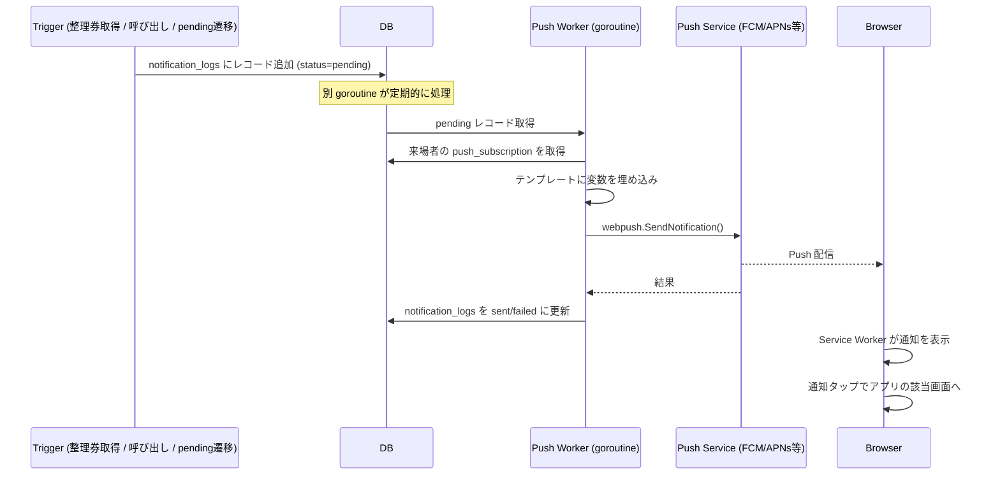

# 機能: 通知

来場者に対する通知。**Web Push 通知 と 画面 polling のハイブリッド**で運用する。メール・LINE・SMS は MVP に含まない。

---

## 1. 機能概要

来場者の整理券に関するイベント(申し込み完了 / 呼び出し / 再通知)を、来場者の端末に通知する。来場者が物理的にブースから離れた場所にいても、呼び出されたことを認識できるようにする。

来場者の状況に応じて 2 系統で通知する:

- **Web Push 通知**: ブラウザを閉じていても届く(VAPID 経由)。来場者が許可した場合のみ
- **画面 polling**: 来場者が画面を開いている時に、数秒ごとに自動更新

両方が機能していれば、Web Push が遅延しても画面 polling で気づける、という冗長性が確保される。

---

## 2. ユーザーストーリー

- 来場者として、整理券取得が完了したことの確認通知を受け取りたい
- 来場者として、自分の順番が来たら速やかに通知してほしい
- 来場者として、呼び出されたが行けなかった場合、再度通知してほしい
- 来場者として、通知を受け取るかどうか選びたい(ブラウザ通知許可ダイアログで決める)
- 来場者として、通知が届かなくても、画面を開けば順番が分かるようにしたい
- 全体管理者として、通知の文面を編集できるようにしたい
- 全体管理者として、通知の配信履歴を確認したい

---

## 3. 通知のタイミングと種類

| イベント | 通知タイミング | テンプレートキー |
|---|---|---|
| 整理券取得完了 | 取得処理が成功した直後 | `application_completed` |
| 呼び出し | スタッフが呼び出し操作をした時 / マッチング成立時 | `call_initial` |
| 再通知(pending 遷移時) | 呼び出し後 N 分経過しても入場処理されない時 | `call_resent` |
| キャンセル(運営側) | 運営側がキャンセルした時 | `cancelled_by_staff`(任意) |
| 入場処理完了 | スタッフが入場処理した時 | なし(画面切り替えで代替、R-010) |

---

## 4. Web Push 通知

### 4-1. 仕組み

- 標準仕様の Web Push (VAPID + Push API)
- ブラウザの Service Worker を介して受信
- 来場者が事前に通知許可を与え、Push サブスクリプションをサーバーに登録している必要がある

### 4-2. 来場者の購読フロー

`features/auth.md` の Web Push 案内画面で実施:

1. 来場者が「通知を有効にする」ボタンを押す
2. ブラウザが通知許可ダイアログを表示
3. 許可されたら Service Worker を登録
4. PushManager.subscribe() で購読情報(endpoint, keys)を取得
5. サーバーに `RegisterPushSubscription` で送信
6. サーバーは `push_subscriptions` テーブルに保存

### 4-3. iOS Safari の制約

- iOS Safari で Web Push を使うには、PWA としてホーム画面に追加する必要がある
- 普通に Safari で開いただけでは Web Push が届かない
- 対策: 来場者には「画面を開いたままにしてください」と案内し、画面 polling でフォールバック

### 4-4. 配信フロー



### 4-5. 同期送信 vs 非同期送信

- 整理券取得直後の確認通知: **同期で notification_logs にエンキュー**(キューイング自体は速い、実配信は別 goroutine)
- 呼び出しの一括送信: **非同期送信**(複数件まとめて送るため)
- MVP では Go の goroutine で簡易ワーカーを実装。本格的なジョブキュー(Redis 等)は将来

### 4-6. 配信失敗時の挙動

- 即時リトライ(最大 3 回、指数バックオフ)
- 全失敗の場合: notification_logs に `status = failed` で記録、エラーメッセージも保存
- 来場者には画面側でも順位を確認できるようにしておく(画面 polling のフォールバック)
- サブスクリプションが期限切れ(410 Gone)の場合: `push_subscriptions` レコードを削除

### 4-7. Push メッセージの構造

```json
{
  "title": "ブース名 - 呼び出し",
  "body": "山田 さん、HMD 体験ブースへお越しください",
  "icon": "https://media.event.example.com/notifications/icons/call.png",
  "data": {
    "ticket_id": "12345",
    "url": "/tickets/12345"
  }
}
```

- `title`, `body` はテンプレートから生成
- `icon` はテンプレートに設定された URL
- `data.url` で通知タップ時の遷移先を指定

### 4-8. Web Push の制約

- 本文は短くする(目安 100 文字以内)
- HTML フォーマットは使えない
- 画像表示は限定的(`icon` は表示されるが、`image` はブラウザにより対応がまちまち)

---

## 5. 画面 polling

### 5-1. 仕組み

- 来場者が画面を開いている間、数秒ごとに自動でステータスを再取得
- 取得した結果に応じて画面を更新
- Web Push が機能しない端末でも順番に気づける保険

### 5-2. polling のロジック

#### マイページ・整理券一覧画面

- 5〜10 秒ごとに `GetMyTickets` を呼ぶ
- 各整理券の状態が変わった場合に画面更新

#### 整理券詳細画面

- 5 秒ごとに `GetTicketStatus` を呼ぶ
- ステータス変化時に大きな視覚変化(色、振動)
- `called` への遷移時はバイブレーション API も併用(対応端末)

#### ブース一覧画面

- 30 秒ごとに `GetBoothList` を呼ぶ(待ち人数の更新用)
- ステータスは表示されているブース数の人数のみ更新

### 5-3. polling の負荷対策

- ブース別の待ち人数等は、サーバー側で **数秒のキャッシュ**を持つ
- 来場者ごとの整理券状態は、TTL を短くするかキャッシュなし
- 同時アクセス 10,000 人 × 5 秒間隔 = 約 2,000 req/s のオーダーになる
- → Connect-RPC のステートレス設計と Cloud Run の自動スケールで対応

### 5-4. 隠れタブ・スリープ時の挙動

- ブラウザのタブが非アクティブな時、ブラウザは setInterval を遅延させる(節電)
- 完全に画面を閉じれば polling は止まる
- → Web Push が必要(ただし iOS Safari の制約あり)

---

## 6. テンプレート管理

### 6-1. テンプレートの構造

`notification_templates` テーブル(data-model.md 参照)。

| カラム | 説明 |
|---|---|
| `key` | 一意な識別子(例: `call_initial`) |
| `title` | Push 通知のタイトル(目安 30 文字) |
| `body` | Push 通知の本文(目安 100 文字) |
| `icon_url` | 通知アイコン(任意) |

### 6-2. テンプレート例

#### `application_completed`(整理券取得完了)

```
title: 整理券を取得しました
body: {{ニックネーム}} さん、{{ブース名}} の整理券を取得しました。順番が近づきましたらお知らせします。
```

#### `call_initial`(初回呼び出し)

```
title: {{ブース名}} - 呼び出し
body: {{ニックネーム}} さん、お時間です。{{場所}} へお越しください。
```

#### `call_resent`(再通知 / pending 遷移時)

```
title: {{ブース名}} - お時間です
body: {{ニックネーム}} さん、お時間ある時にいつでもお越しください。{{場所}} でお待ちしています。
```

### 6-3. 変数の埋め込み

利用可能な変数:

- `{{ニックネーム}}`: 来場者のニックネーム
- `{{受付番号}}`: 受付番号(A-105 等)
- `{{ブース名}}`: ブース名
- `{{場所}}`: ブースの開催場所
- `{{整理券番号}}`: 整理券番号

実装時の置換ロジックは Go 側に集約(`internal/feature/notification/template.go` 等)。バリデーション: 不明な変数 → エラー。

### 6-4. テンプレートの編集

全体管理者のみが編集可能(`features/admin.md` 参照)。

---

## 7. 配信ログ

### 7-1. ログの保存

`notification_logs` テーブル(data-model.md 参照)。

| カラム | 内容 |
|---|---|
| `ticket_id` | 関連する整理券 |
| `template_id` | 使われたテンプレート |
| `endpoint_masked` | Push エンドポイント URL の一部のみ(PII 配慮) |
| `status` | `sent` / `failed` / `skipped` |
| `error_message` | 失敗時の理由 |
| `sent_at` | 送信時刻 |

### 7-2. ログ表示

全体管理者のダッシュボードで:

- 直近 24 時間の送信成功 / 失敗数
- 失敗ログの詳細(再送ボタン付き)

### 7-3. ログのマスキング

- Push エンドポイントには個人情報的なトークンが含まれる可能性があるため、ログには先頭 30 文字のみ記録
- それ以上の詳細はアプリログにも残さない(R-019)

---

## 8. 個人情報の扱い

- メールアドレス・LINE userId 等は取得しないため、Push サブスクリプションのみが連絡先情報
- Push サブスクリプションは Web Push サービスに依存し、ユーザーが許可を取り消したら無効化
- ログには Push エンドポイントをそのまま出さず、マスク済みのみ
- 通知本文には個人情報を最小限のみ含める(ニックネームと整理券情報程度)

---

## 9. エラーケースと UX

| エラー | UX |
|---|---|
| Push 送信失敗(一時的) | リトライキューに戻す、ユーザーには表示しない |
| Push 送信失敗(エンドポイント無効) | サブスクリプションを削除、画面 polling のみで運用 |
| 通知許可拒否 | 「画面を開いたままにしてください」と案内 |
| Service Worker 登録失敗 | エラーログのみ、画面 polling で代替 |
| テンプレートに不正な変数 | 全体管理者の編集画面でバリデーションエラー |
| iOS Safari で許可不可 | 画面 polling でフォールバック |

---

## 10. テスト方針

通知は**重要箇所**(呼び出しに気づかない = 運営の信頼性低下)。

- テンプレートの変数置換: TDD で書く(文字列処理の純粋ロジック)
- 配信キューへの投入: TDD で書く
- Push サブスクリプションの管理(登録・無効化): TDD で書く
- 失敗時のリトライロジック: TDD で書く
- 410 Gone 時のサブスクリプション削除: TDD で書く
- 実際の Web Push 配信: モックで Integration テスト、実機での動作確認は別途
- 画面 polling: フロントエンドの hook テストで書く

---

## 11. 未決定事項

- Push メッセージの送信レート制限(配信過多にならないよう)
- 通知のオプトアウト方法(来場者が後から「通知不要」と選べるようにするか)
- LINE 連携を v2 で追加する際のテンプレート分離方針
- iOS PWA インストール案内の UI 設計
- 配信失敗時の運営側のアラート手段(画面表示のみ vs 別チャネル通知)
- 画面 polling の間隔の最適値(現仕様: 整理券詳細 5 秒、ブース一覧 30 秒)
