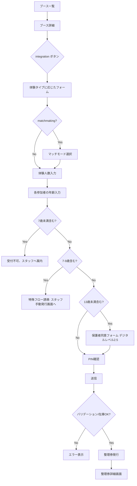

# 機能: 整理券予約・管理

来場者がブースを選んで整理券を取得し、待ち順を確認する機能。本システムの中核。ブースの体験タイプ(4 種)に応じて挙動が変わる。マッチメイキング型の固有ロジックは `features/match.md` を参照。

---

## 1. 機能概要

来場者が興味のあるブースを選び、必要情報を入力して整理券を取得する。整理券取得後は待ち人数や順番を確認でき、呼び出されると Web Push 通知 + 画面更新で通知を受ける。13 歳未満を含む場合は保護者同意フローが追加で必要となる。

---

## 2. ユーザーストーリー

- 来場者として、ブース一覧から行きたいブースを選びたい
- 来場者として、自分と同行者の年齢を入力して、整理券を予約したい
- 来場者として、自分の整理券の待ち順・残り人数を確認したい
- 来場者として、別の人が代表者として複数人分まとめて予約することを許容したい
- 来場者として、呼び出されたタイミングで通知を受け取りたい
- 来場者として、必要なら整理券をキャンセルしたい
- 来場者として、呼び出された後に遅れても、後でも体験できるなら、後から行きたい

---

## 3. 体験タイプ(experience_type)

ブースは 4 種類のいずれか(R-015)。各タイプで整理券の取得・呼び出し・体験の挙動が異なる。

### 3-1. `sequential`(順次体験型)

- 1 整理券で 1〜N 人のグループ
- 呼ばれたら全員一緒にブースへ向かう
- ブース内では 1 人ずつ順次体験
- 例: HMD 1 台で家族 4 人が順次体験

待ち時間 = 自分より前の参加者総人数 × `estimated_minutes_per_person`

### 3-2. `parallel`(同時並行型)

- 1 整理券で 1〜N 人のグループ
- 呼ばれたら全員一緒にブースへ向かう
- グループ内全員が同時に HMD 装着し、並行体験
- ブース内の同時体験可能人数(`concurrent_capacity`)を超える場合は分割
- 例: HMD 4 台で家族 4 人が同時体験

待ち時間 = ceil(自分より前の人数 / `concurrent_capacity`) × `estimated_minutes_per_session`

### 3-3. `individual`(個人体験型)

- 1 整理券は必ず 1 人
- 家族で来てもそれぞれ別々に整理券を取得
- 別々に呼ばれる
- 例: HMD 1 台で 1 人ずつ

待ち時間 = 自分より前の整理券数 × `estimated_minutes_per_person`

### 3-4. `matchmaking`(マッチメイキング型)

- 1 整理券で 1〜N 人のグループ
- 整理券取得時にマッチモード(public / private)を選択
- public: 他のグループと結合して `target_party_size` 人で開催
- private: 自分のグループ内のみ(`min_party_size` 以上)で開催
- 詳細は `features/match.md` を参照

---

## 4. 整理券取得フロー



---

## 5. 画面と振る舞い

### 5-1. ブース一覧画面

- 全ブースをカードレイアウトで表示
- 各カードに表示する情報:
  - ブース名
  - 開催場所
  - 体験タイプ(アイコン or バッジで表示)
  - 現在の待ち人数 / 想定待ち時間
  - ブース紹介画像(R2 上の URL)
  - 「詳細を見る」ボタン
- 待ち人数は数十秒ごとに自動更新(画面 polling)
- ソートやフィルター: MVP では不要(ブース数が多くない想定)

### 5-2. ブース詳細画面

- ブース名・説明・所要時間
- 体験タイプの表示(順次/同時/個人/マッチング)
- 体験の様子の動画(YouTube 埋め込み、`intro_video_url` から)
- ブース画像(R2 から配信)
- 待ち人数 / 想定待ち時間
- 「整理券を取得する」ボタン
- 既に取得済みの場合は「整理券を確認する」ボタンに変わる
- クールダウン中の場合は「次回取得可能時刻」を表示

### 5-3. 整理券取得フォーム

#### 共通項目(全タイプ)

| 項目 | 必須 | バリデーション |
|---|---|---|
| 代表者ニックネーム | 必須 | デフォルトで自分の登録ニックネームを表示 |
| 4 桁 PIN | 必須 | 認証確認のため再度入力 |

#### タイプ別の追加項目

**sequential / parallel / matchmaking**:

| 項目 | 必須 | バリデーション |
|---|---|---|
| 体験人数 | 必須 | 1〜`max_participants_per_ticket`(matchmaking では `target_party_size` まで) |
| 各参加者の年齢 | 必須 | 0〜120 |
| 各参加者の氏名 | 13 歳未満含む場合のみ必須 | 1〜30 文字 |

**individual**:

| 項目 | 必須 | バリデーション |
|---|---|---|
| 自分の年齢 | 必須 | 7〜120 |
| 氏名 | 13 歳未満の場合のみ必須 | 1〜30 文字 |

**matchmaking 固有**:

| 項目 | 必須 | バリデーション |
|---|---|---|
| マッチモード | 必須 | `public` / `private`(ブースの `allow_private_match` が false なら `public` 固定) |

備考:

- 体験人数を選ぶと、その人数分の年齢入力欄が動的に増える
- 7 歳未満が 1 人でも含まれていれば、エラーメッセージで受付不可を伝え、フォーム送信を止める
- 7〜9 歳が 1 人でも含まれていれば、「受付スタッフへお越しください」のメッセージを表示し、特殊フローへ誘導
- 13 歳未満(10〜12 歳)が含まれていれば、保護者同意セクションが表示される

### 5-4. 保護者同意フォーム(10〜12 歳を含む場合)

R-005-2 のレベル 2.5。

#### 表示内容

- リスク説明文の本文(`risk_explanations.body` から取得)
- 同意のチェックボックス: 「上記内容に同意し、保護者として責任を負います」
- 保護者氏名入力欄(必須)
- 各 13 歳未満参加者の氏名(各人分必須、共通項目で入力済みのものを表示)

#### UI 制御

- リスク説明文を **末尾までスクロール** しないと、同意ボタンが押せない
- 同意ボタンを押した瞬間に:
  - 同意した時点の説明文の本文を取得して保存
  - クライアントの IP / User Agent を取得(サーバー側で記録)
  - 同意時刻を記録

### 5-5. 7〜9 歳を含む場合の特殊フロー誘導

オンライン側で受付完了せず、以下の案内を表示:

```
このご予約には保護者の同意が必要です。
受付スタッフのいるブースに直接お越しください。
保護者の方の同意書(用紙)をご記入いただき、スタッフが整理券を発行いたします。
```

この場合、整理券は来場者がオンラインで取得できず、スタッフ側の管理画面から発行する。詳細は `features/admin.md` の「特殊フロー手動発行」を参照。

### 5-6. 整理券詳細画面

#### 表示内容(共通)

- ブース名・場所
- 整理券番号(発行されたもの。受付番号とは別概念)
- 自分の現在の順位 / 残り待ち人数
- 想定呼び出し時刻
- ステータス
- 「キャンセルする」ボタン(`waiting` / `called` / `pending` 状態で表示)

#### 状態別の追加表示

| 状態 | 追加表示 |
|---|---|
| `waiting` | 順位、残り待ち人数、想定待ち時間 |
| `called` | 「呼び出されました!」(背景色を変えて目立たせる)、ブース場所、バイブレーション |
| `pending` | 「保留中です。お時間ある時にいつでもお越しください」、再通知ボタン |
| `admitted` | 「ご参加ありがとうございました」+ アンケート誘導(`survey_url` へのリンク) |
| `cancelled` | 「キャンセル済み」表示、再取得ボタン(クールダウン中なら時刻表示) |

### 5-7. マイページの整理券一覧

- 自分が保持している整理券をカード形式でリスト表示
- 各カードに: ブース名 / 順位 / ステータス
- カードをタップすると整理券詳細画面へ
- ステータスごとに色分け(視認性)

---

## 6. サーバー側の処理

### 整理券取得(`CreateTicket`)

入力:
- 来場者の受付番号(認証済みコンテキストから)
- ブース ID
- マッチモード(matchmaking のみ)
- 体験人数
- 各参加者の年齢配列・氏名配列(13 歳未満のみ氏名必須)
- 保護者同意の情報(13 歳未満を含む場合)
- 確認用 PIN

処理:
1. PIN を検証(認証強化のため)
2. ブースが存在し、整理券取得可能な状態か確認(`is_accepting`、`open_at`〜`close_at` 内)
3. 7 歳未満を含む場合はエラー
4. 7〜9 歳を含む場合はエラー(オンライン取得不可)
5. 同じ来場者が同じブースで `waiting` / `called` / `pending` の整理券を持っていないか確認(R-006、R-007 のユニーク制約に依存)
6. クールダウンチェック: 直近の admitted から `cooldown_minutes` 経過しているか
7. 13 歳未満を含む場合、保護者同意の情報を検証
8. ブース内のシーケンス番号を採番して整理券を発行
9. Ticket / TicketGroup / Participant / ParentalConsent を作成、状態は `waiting`
10. 申し込み完了通知(`application_completed`)を notification_logs にエンキュー

(matchmaking ブースでは追加の処理あり、`features/match.md` 参照)

出力:
- 整理券の詳細(整理券番号、現在の順位、ステータス)

### 待ち状況確認(`GetTicketStatus`)

入力:
- 整理券 ID または(受付番号 + ブース ID)

処理:
1. 整理券を取得
2. 同じブースの自分より前の `waiting` 整理券の数を数える
3. ステータスと順位を返す

出力:
- 整理券のステータス、順位、ブース情報

### キャンセル(`CancelTicket`)

入力:
- 整理券 ID
- 確認 PIN

処理:
1. 認証確認
2. 状態が `waiting` / `called` / `pending` であることを確認(R-014)
3. 状態を `cancelled` に変更
4. 後続の整理券の順位を再計算する必要は **ない**(発行順を保持するため)
5. matchmaking ブースで called だった場合、関連する match_session の整合性を確認(`features/match.md` 参照)

### 自動 pending 遷移(バックグラウンド)

入力: 定期実行(数十秒ごと)

処理:
1. `called` 状態かつ `called_at + call_resend_minutes < now()` の整理券を検索
2. 該当する整理券を `pending` に遷移、`pending_at` を更新
3. 再通知(`call_resent`)を notification_logs にエンキュー
4. 待機列のカウントから除外される(自動的に、status が `pending` だから)

### pending からの復帰(QR スキャン時)

入力:
- 来場者の受付番号(QR から)
- ブース ID(スキャンしたスタッフのブース)

処理:
1. 該当する整理券を取得
2. 状態が `pending` の場合、`called` に遷移、`is_priority_call = true`、`returned_at` を更新
3. 通常の入場処理は別 RPC(`AdmitTicket`)で行う

---

## 7. データの一貫性とトランザクション

### 整理券取得時のトランザクション境界

以下を 1 つのトランザクション内で実施:

- 重複チェック(同一来場者・同一ブースで waiting/called/pending なし)
- クールダウンチェック
- ブース内シーケンス採番
- Ticket / TicketGroup / Participant / ParentalConsent 作成

### 順位計算の戦略

- 順位は整理券取得時に固定値として保存しない
- 取得のたびに「自分より前で `waiting` または `called` の整理券数」を数える
- pending は数えない(R-012)
- 理由: キャンセルや状態変化があるたびに順位が動くため

### スケール対策

- ブース別の現在の `waiting` カウントをキャッシュする(数秒程度の TTL)
- 待ち人数の表示は数秒の遅延を許容する

---

## 8. エラーケース

| エラー | UX |
|---|---|
| 既に同じブースで整理券保持中 | 「既にこのブースの整理券をお持ちです」+ 整理券詳細リンク |
| クールダウン中 | 「前回の体験から N 分経過していません。X 時 Y 分以降に再取得可能です」 |
| ブースが取得停止状態 | 「現在このブースは整理券の発行を停止しています」 |
| ブースの開催時間外 | 「このブースは現在受付時間外です」 |
| PIN 不一致 | 「PIN が違います」(再入力を促す) |
| 7 歳未満を含む | 「7 歳未満の方はご参加いただけません」 |
| 7〜9 歳を含む | 「保護者の方が受付スタッフへお越しください」 |
| 13 歳未満含むのに同意なし | フォームバリデーションで送信前に検出 |
| ネットワーク失敗 | 「もう一度お試しください」 |
| matchmaking ブースで人数超過 | 「最大 N 人まで指定可能です」 |

---

## 9. テスト方針

整理券取得は**重要箇所**(取得失敗・重複発行は運営の信頼に直結する)。

- 整理券取得の正常フロー: TDD で書く
- 重複取得の防止(R-007 ユニーク制約): TDD で書く
- クールダウンチェック: TDD で書く
- 7 歳未満・7〜9 歳の弾き: TDD で書く
- 13 歳未満を含む場合の保護者同意必須: TDD で書く
- 自動 pending 遷移: TDD で書く
- pending からの復帰と優先呼び出し: TDD で書く
- キャンセルと順位計算: アフターで OK
- 待ち人数表示: アフターで OK
- ブース一覧表示: アフターで OK

E2E で押さえるべき動線:

- ブース一覧 → 整理券取得 → マイページで確認(主要な動線)
- 13 歳未満の参加者を含む取得フロー(例外的だが重要)
- 呼び出し → 入場処理(QR スキャン)
- 呼び出し → No Show → pending → 戻ってきて優先呼び出し

---

## 10. 未決定事項

- 想定待ち時間の計算で過去データを使うか、ブース設定値固定か
- 「呼び出されたが現れなかった」の自動失効ルール(MVP では失効せず pending で保持)
- 整理券のキャンセル可能タイミングを `pending` でも許容(現仕様で OK)
- 保護者同意フォームの文言テンプレート(運営側で事前準備が必要)
- マッチメイキング固有のエッジケース → `features/match.md` の未決定事項参照
